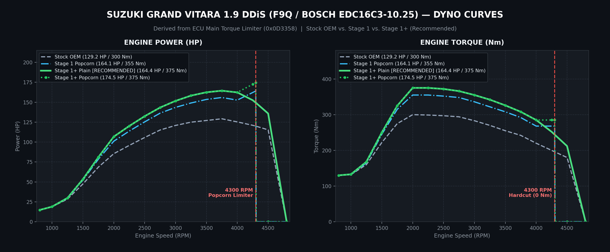

# Suzuki Grand Vitara 1.9 DDiS (F9Q / Bosch EDC16C3-10.25) — ECU Tuning Package

Calibrated and byte-verified ECU software package for the **Suzuki Grand Vitara 1.9 DDiS** (`F9Q` engine, 5-speed manual, factory 129 HP / 300 Nm).

## Vehicle & ECU Specifications

| Parameter | Value |
| :--- | :--- |
| **Vehicle / Engine** | Suzuki Grand Vitara 1.9 DDiS (`F9Q-B264`, 5-speed manual, 4x4) |
| **Stock Output** | 129.2 HP @ 3750 RPM / 300.0 Nm @ 2000 RPM |
| **ECU Hardware** | Bosch `EDC16C3-10.25` — HW: `8200638060` |
| **ECU Software** | SW: `1037382039P500_V50` (`V30_W84`) |
| **Binary Format** | `1,048,576 bytes` (1.00 MB — Kess V2 OBD read/write) |
| **Checksum Rule** | `SumBE32(0x0C0000..0x0FDF7F) == 0xD01FE500` (4-byte checksum at `0x0FDF7C..0x0FDF7F`) |

---

## Dyno Power & Torque Curves

| Engine RPM | Stock OEM (Nm / HP) | Stage 1 Popcorn (Nm / HP) | **Stage 1+ Plain (Nm / HP)** | **Stage 1+ Popcorn (Nm / HP)** |
| :---: | :---: | :---: | :---: | :---: |
| **1000** | 132 Nm / 18.8 HP | 132 Nm / 18.8 HP | **133 Nm / 18.9 HP** | **133 Nm / 18.9 HP** |
| **1500** | 222 Nm / 47.4 HP | 245 Nm / 52.3 HP | **250 Nm / 53.4 HP** | **250 Nm / 53.4 HP** |
| **1750** | 275 Nm / 68.5 HP | 315 Nm / 78.5 HP | **325 Nm / 81.0 HP** | **325 Nm / 81.0 HP** |
| **2000** | **300 Nm** / 85.4 HP | **355 Nm** / 101.1 HP | **375 Nm / 106.8 HP** | **375 Nm / 106.8 HP** |
| **2500** | 297 Nm / 105.7 HP | 352 Nm / 125.3 HP | **372 Nm / 132.4 HP** | **372 Nm / 132.4 HP** |
| **3000** | 283 Nm / 120.9 HP | 336 Nm / 143.5 HP | **355 Nm / 151.6 HP** | **355 Nm / 151.6 HP** |
| **3500** | 255 Nm / 127.1 HP | 308 Nm / 153.5 HP | **326 Nm / 162.5 HP** | **326 Nm / 162.5 HP** |
| **3750** | 242 Nm / **129.2 HP** | 292 Nm / 155.9 HP | **308 Nm / 164.4 HP** | **308 Nm / 164.4 HP** |
| **4000** | 220 Nm / 125.3 HP | 268 Nm / 152.6 HP | **285 Nm / 162.3 HP** | **285 Nm / 162.3 HP** |
| **4300** | 196 Nm / 120.0 HP | 268 Nm / **164.1 HP** | **244 Nm / 149.4 HP** | **285 Nm / 174.5 HP** |
| **4305** | 196 Nm / 119.9 HP | **0 Nm (Hardcut)** | **243 Nm / 149.1 HP** | **0 Nm (Hardcut)** |

---

## Included Binaries (All Checksum-Verified)

| File | Output (Est.) | Idle / A/C Idle | Rev Limiter | Checksum (`0x0FDF7C`) | Notes |
| :--- | :---: | :---: | :---: | :---: | :--- |
| **`original_suzuki_fabrika.bin`** | 129 HP / 300 Nm | 800 RPM (Stock) | 4800 RPM (Stock) | `0xA6A826E2` | Untouched factory reference (factory DPF-off calibration) |
| **`org.bin`** | 129 HP / 300 Nm | 800 RPM (Stock) | 4800 RPM (Stock) | `0xB32F5EFA` | Earlier stock OBD read |
| **`Suzuki_Grand_Vitara_Stage1_PLUS_EGR_N75_OK.bin`** | **~168 HP / 375 Nm** | 800 RPM (Stock) | 4800 RPM (Stock) | `0xC8F8793B` | **Recommended (Daily / Safe Max)** — Stage 1+, EGR/TVA OFF, N75/VNT Protected |
| **`Suzuki_Grand_Vitara_Stage1_PLUS_Klima950_EGR_N75_OK.bin`** | **~168 HP / 375 Nm** | **800 / A/C ON: 950 RPM** | 4800 RPM (Stock) | `0xC7CC780F` | **Recommended (Daily + A/C 950 RPM)** — Raises idle to 950 RPM only when A/C is ON |
| **`Suzuki_Grand_Vitara_Stage1_PLUS_Popcorn_EGR_N75_OK.bin`** | **~168 HP / 375 Nm** | 800 RPM (Stock) | **4300 RPM Hardcut** | `0xE45C90CC` | Stage 1+ with 4300→4305 RPM Popcorn hardcut limiter |
| **`Suzuki_Grand_Vitara_Stage1_PLUS_Popcorn_Klima950_EGR_N75_OK.bin`** | **~168 HP / 375 Nm** | **800 / A/C ON: 950 RPM** | **4300 RPM Hardcut** | `0xE3308FA0` | Stage 1+ with 4300 RPM Popcorn hardcut + A/C-ON 950 RPM idle |
| **`Suzuki_Grand_Vitara_Stage1_Popcorn_EGR_N75_OK.bin`** | ~158 HP / 355 Nm | 800 RPM (Stock) | **4300 RPM Hardcut** | `0x1CF9D723` | Mild Stage 1 with 4300 RPM Popcorn hardcut |

---

## Key Calibration Highlights

- **N75 / VNT Protection & Boost Limp-Mode Fix:**
  - Startup delay timers (`0x0F0788..0x0F078D` = `150, 100, 700`), PID regulator windows (`0x0EF7EE..0x0EF8FD`), and VNT base maps are **100% factory stock** for immediate startup vacuum and safe high-RPM boost bleed.
  - Minimum duty cycle (`PCR_rMin_CUR` `0x0EFAD4`, `PCR_rMin_C` `0x0EFFD4`, `PCR_rDflVal` `0x0F06FE`) restored to factory `410` (`5%`) so VNT vanes never lock at high duty.
  - Boost deviation (`P0243`) and N75 circuit (`P0033`/`P0034` — `BPACD`) DTC fault classes and `DSM_InhDfp` turbo-cut inhibitions (`0x0CC6BC..0x0CC6E0`, `0x0CC9C2..0x0CC9D8`) disabled (`0x00`) to prevent nuisance turbo limp-mode while widening deviation bounds (`PCR_pDvtMax/Min`) to `±650 mbar` / `750 mbar`.
- **Complete EGR & TVA (`P0638`) Delete:**
  - All 4 EGR hysteresis curves (`0x0C6F18`, `0x0C7008`, `0x0C7084`, `0x0C70BE`) zeroed; open-loop EGR maps (`0x0C69B2`, `0x0C6BF6`) set to `8192` (`0%` duty).
  - EGR and TVA (`P0638`) DTC classes and `DSM_InhDfp` inhibitions zeroed (`P0651` 5V Sensor Reference B kept active for diagnostic safety).
- **Engine-Safe Stage 1+ Calibration (~168 HP / 375 Nm):**
  - Soft low-RPM ramp (`1000–1500 RPM`) to protect `F9Q` conrod bearings and dual-mass flywheel; `375 Nm` peak from `2000–2250 RPM`.
  - Gearbox master input torque limit (`Gearbx_trqInMax_C` at `0x0D7820`) raised from stock `335 Nm` to `385 Nm` (`360 Nm` on Stage 1), with 1st/Reverse capped at `315 Nm` and gears 2–5 at `385 Nm`.
  - Peak boost raised conservatively from `1.51 bar` to `1.55 bar` (`2550 mbar`) mid-range, tapering to `1.38 bar` at `4000+ RPM` to protect the Garrett `GT1749V` shaft (`SVBL = 2700 mbar`).
  - Factory `1600 bar` peak rail pressure ceiling is **never exceeded**; clean smoke-free `1.10 Lambda` (`15.95:1 AFR`) and `+1.0°..+1.4°` full-load SOI advance.
- **4300 RPM Popcorn Hardcut (`Popcorn` variants):**
  - Synchronized `4300 -> 4305 RPM` (`5 RPM` step) zero-torque fuel cut across Torque Limiters `0x0D3358`, `0x0D403C`, and Driver Wish `0x0C11F8`.
- **A/C-ON 950 RPM Idle (`Klima950` variants):**
  - Only `ACCtl_nMin_CUR` (`0x0C1828..0x0C182F`) is raised from `800` to `950 RPM`. When A/C is OFF, idle stays at factory `800 RPM`. Undershoot compressor shutoff (`0x0C17A2`) remains factory `[780, 750] RPM` for uninterrupted cooling at idle.

---

## Documentation & Dyno Report

- **[TECHNICAL_REPORT.md](./TECHNICAL_REPORT.md)** — Full technical documentation, hex map addresses, torque/power table, and audit changelog.
- **[Suzuki_Grand_Vitara_1.9_DDiS_Dyno_Curve_and_Report.pdf](./Suzuki_Grand_Vitara_1.9_DDiS_Dyno_Curve_and_Report.pdf)** — 2-page Dyno HP/Nm curves & calibration summary PDF report.

---

> **Disclaimer:** These binaries are calibrated strictly for **Suzuki Grand Vitara 1.9 DDiS** vehicles matching **SW `1037382039P500_V50` / HW `8200638060`** (`Bosch EDC16C3-10.25`). Always take a full backup of your vehicle's original ECU flash before writing. Use at your own risk; off-road / motorsport use where applicable.
